# HA List Manager

**Shopping lists, inventory and tasks — together in Home Assistant.**

English · [Deutsch](README_DE.md) · [Wiki](https://github.com/Nisbo/ha-list-manager/wiki)

HA List Manager builds on the original
[Improved Shopping List Card](https://github.com/Nisbo/ha-shopping-list-improved),
adding a shared product database and central administration in Home Assistant.

<!-- ha-marketplace:exclude-start -->

<!-- ha-marketplace:exclude-end -->

Plan your shopping, keep track of supplies and manage recurring tasks. Use the
three dashboard cards separately or together. Shopping and inventory share a
product database; categories, labels and quick entries help organize the lists.
The interface and complete wiki are available in English and German.

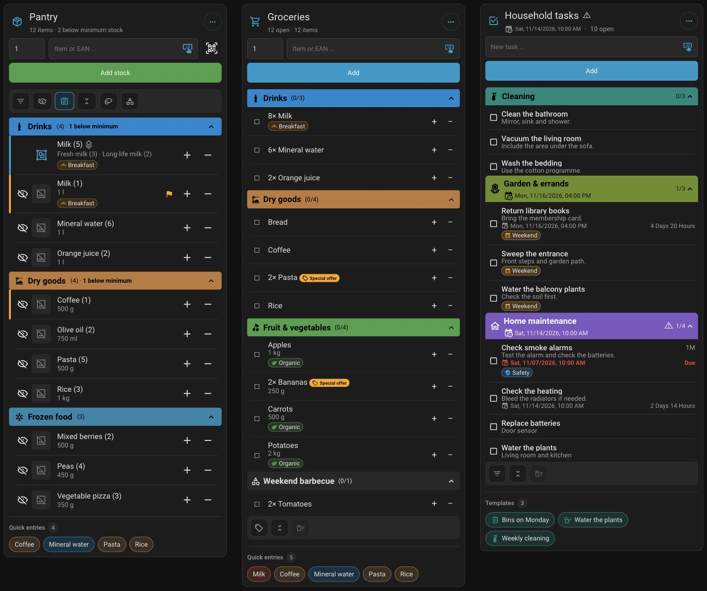

## Three kinds of lists

### Shopping lists

- Add free-text items or select saved products with pictures and package sizes.
- Track quantities and descriptions.
- Reuse quick entries and mark items to buy **only when on offer**.
- Filter offers and search items.
- Add ingredients from saved dishes or Tandoor recipes to local shopping lists.
- Send an item to another shopping list, export a PDF or send notifications.
- Connect a Bring! list through Home Assistant's official Bring! integration.

### Inventory

- Manage separate stock lists for the kitchen, freezer or storage room.
- Book products in or out, correct stock and undo the last manual booking for 60 seconds.
- Scan barcodes to book products in or out, or adjust stock with the plus/minus buttons.
- Set minimum stocks and replenish manually or automatically to a shopping list.
- Choose replenishment rules per list, product or interchangeable-product group.

### To-do lists

- Organize tasks with notes, due dates, times and repeat intervals.
- Create reusable task templates and configure due-date warnings.
- Search tasks, sort by due date and hide completed tasks.
- Keep tasks independent from products and barcodes.

**Mobile card layouts in the dashboard**

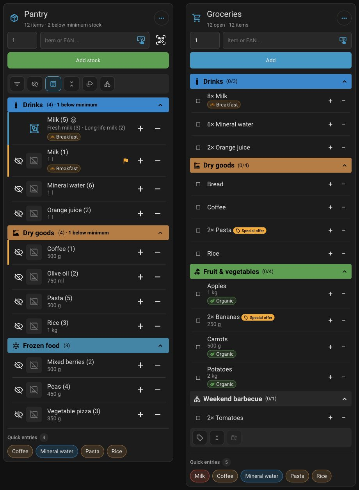

## Alexa shopping

Say “Alexa, add cucumbers to the shopping list” and have the entry arrive in
HA List Manager. This uses an existing list from Home Assistant's **Alexa Devices**
integration, assigned to one local shopping list.

- **Alexa input (recommended):** import new entries and delete them from Alexa by default.
- **Sync linked items:** also synchronize status, deletion and optional quantities.
- **Sync including new local items:** additionally send future new local items to Alexa.

Optional number and unit recognition handles spoken quantities. Aliases turn
several phrases into a particular product or replacement name. Preview the
result in the **Test** tab before using your settings.

## Dishes and optional Tandoor connection

- **Save your own dishes:** Combine free-text ingredients or linked products,
  such as tomatoes, onions and garlic for tomato soup. When adding a dish,
  select ingredients, adjust counts and review categories.
- **Connect Tandoor Recipes (optional):** Set up an existing Tandoor instance
  with its address and API token under **HA List Manager → Settings**. Search
  recipes or select a cookbook in the shopping card, adjust servings and add
  the ingredients you need to the shopping list. Serving adjustments require
  serving information in the recipe.

Enable dishes and Tandoor separately for each local shopping list. Adding
ingredients updates the shopping list without booking any inventory stock.

[Guide to dishes and recipes](https://github.com/Nisbo/ha-list-manager/wiki/Chips-Dishes-and-Recipes)

## Categories and labels across all three list types

- **Categories** divide a list into sections such as Drinks, Bakery or Household.
  Each entry belongs to one category or to General.
- **Multiple labels per entry** add another way to organize it. Milk can belong
  to Drinks and carry both Breakfast and Lactose-free labels. Tasks could use
  Garden and Weekend.
- **Group by category or label:** in the label view, an entry appears under each
  of its labels. It remains the same entry: quantities, completion state and edits
  update in every view.
- **Share definitions or keep them separate:** categories and labels can apply
  globally, to a list type or to one list, each with an icon and color. When names
  match, the individual list takes priority over the list type and global scope.
- **Select and edit quickly:** use search, dropdowns, selection popups or the
  shortcut buttons in the item editor.

Automatic category assignments place new entries by name. Quick entries and
task templates instead help you add recurring items or tasks with fewer taps.

## Product database

Keep a shared product catalog with optional EAN, brand, package size and image.
Unknown barcodes can be looked up through Open Food Facts; product data remains
editable. Removing a shopping entry does not delete its product or change stock.

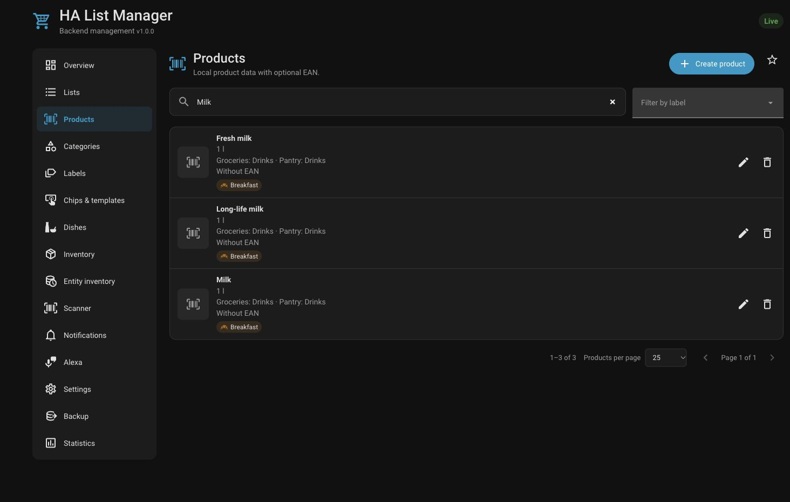

### Inside the item editor

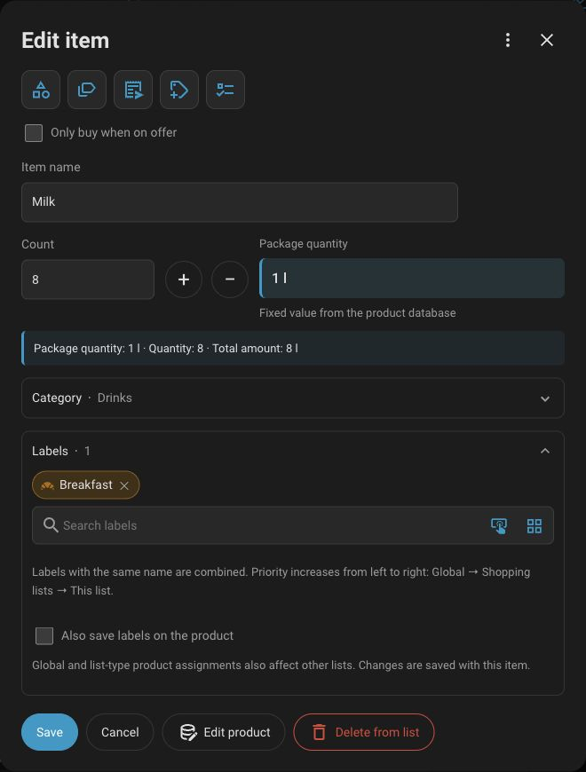

## Shared use and backups

- Updates reach open cards on other devices. Barcode scans are processed centrally,
  even without an open dashboard, with a shared queue for unfinished scans.
- Normal signed-in users operate the list cards; administration is reserved for admins.
- Assign an HA script to a list and choose which events trigger notifications or speech.
- Create, download and restore backups, or import lists from the original Improved Shopping List Card.

## Entity history

Archive selected HA entities long-term, import old history, and correct or hide
measurements. The separate **entity-history card** displays up to five entities
as a chart or chronological list, with reference lines and configurable precision.

**Chart**

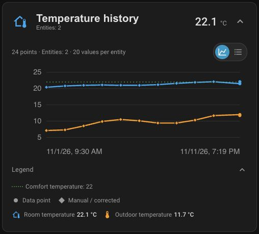

**Chronological list**

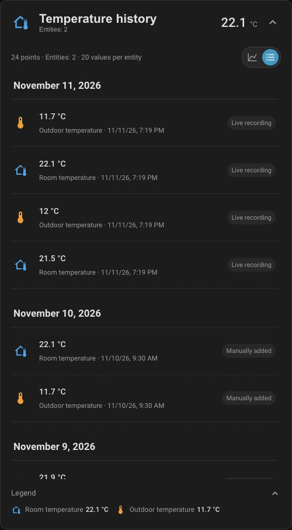

## Large panel views

Open a list in a large panel to give its contents more room. The same lists
remain available in the compact dashboard cards.

### Shopping list

**PC**

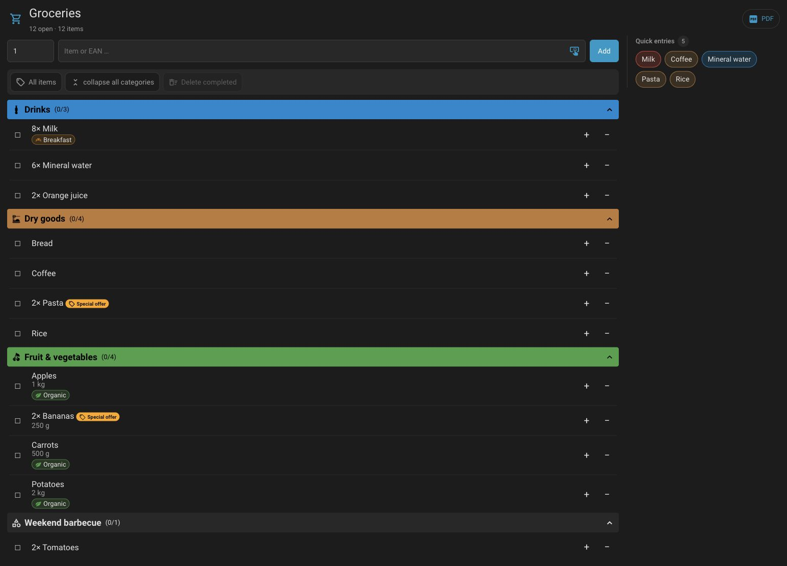

**Tablet**

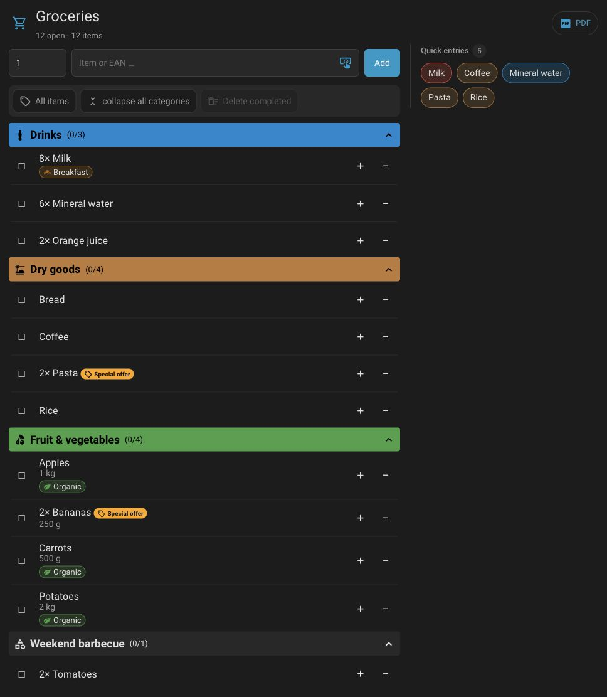

### Inventory

**PC**

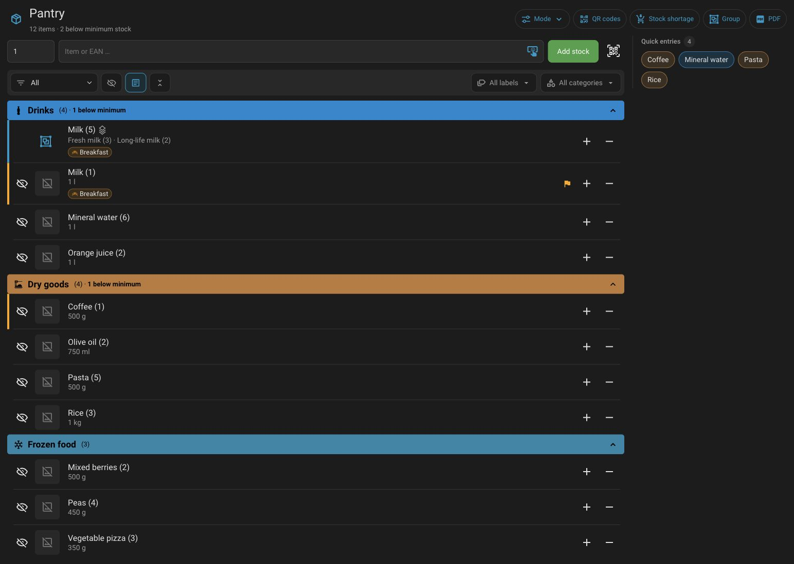

**Tablet**

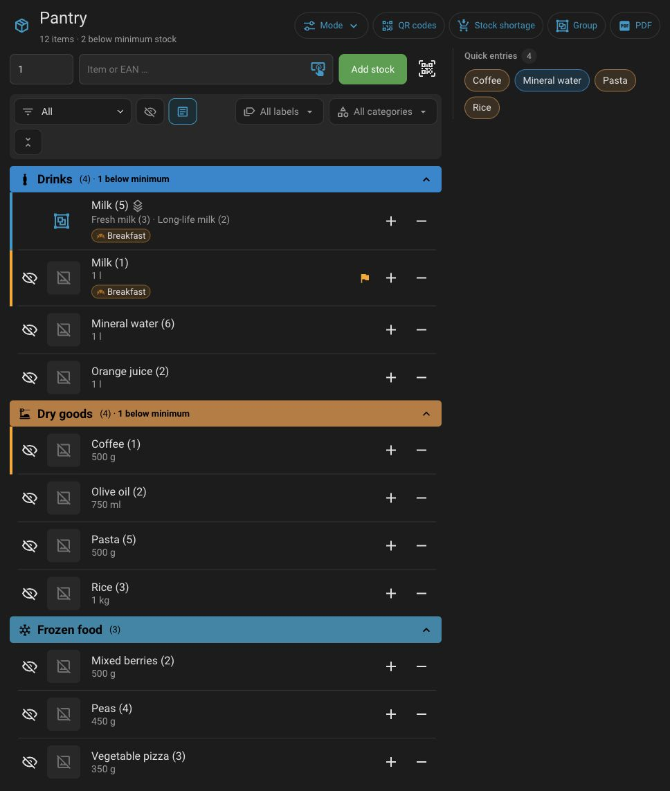

### To-do list

**PC**

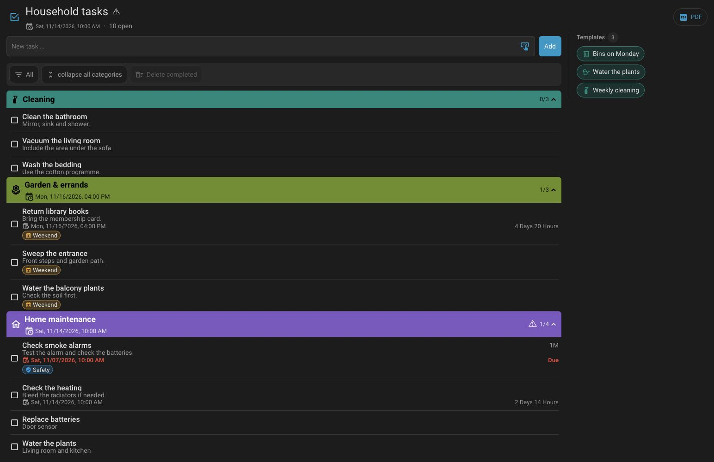

**Tablet**

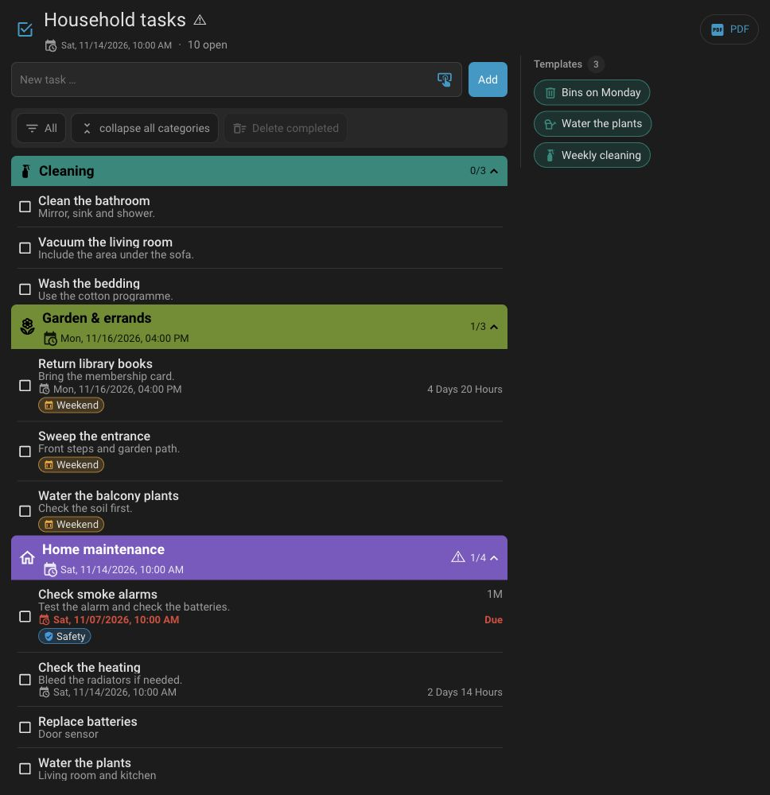

<!-- ha-marketplace:exclude-start -->
## Installation

Use **Marketplace** in Home Assistant **2026.11 or newer**. Installation and
setup require an administrator account.

1. Click the blue button, or open **Settings → Marketplace → Add from link**
   and enter `https://github.com/Nisbo/ha-list-manager`.
2. Connect GitHub if prompted, select **Integration** and install HA List Manager.
   Restart Home Assistant when installation is complete.
3. Open **Settings → Devices & services → Add integration** and select **HA List Manager**.
4. In the HA sidebar, open **HA List Manager → Lists → Create list**
   and select the list type you want.
5. Edit your dashboard, choose **Add card** and search for **HA List Manager**.
   Select **HA List Manager – Shopping list**, **HA List Manager – Inventory** or
   **HA List Manager – To-do list**, then choose the list you created in the card.
   For recorded entity history, select **HA List Manager – Entity inventory**.

**Manual installation (HA 2026.10+):** download the installation archive from
[Releases](https://github.com/Nisbo/ha-list-manager/releases), extract it so
`custom_components/ha_list_manager/manifest.json` is inside your HA configuration
directory, restart HA and continue with step 3.
<!-- ha-marketplace:exclude-end -->

## Guides and help

[Quick Start](https://github.com/Nisbo/ha-list-manager/wiki/Quick-Start) ·
[Shopping](https://github.com/Nisbo/ha-list-manager/wiki/Shopping-Lists) ·
[Inventory](https://github.com/Nisbo/ha-list-manager/wiki/Inventory) ·
[To-do](https://github.com/Nisbo/ha-list-manager/wiki/To-do-Lists) ·
[Alexa](https://github.com/Nisbo/ha-list-manager/wiki/Alexa) ·
[Dishes and recipes](https://github.com/Nisbo/ha-list-manager/wiki/Chips-Dishes-and-Recipes) ·
[Scanners](https://github.com/Nisbo/ha-list-manager/wiki/Scanners) ·
[Backups](https://github.com/Nisbo/ha-list-manager/wiki/Backup-and-Restore)

Report problems or suggest improvements in [GitHub Issues](https://github.com/Nisbo/ha-list-manager/issues).

[MIT License](LICENSE) · [Bundled PDF library license](custom_components/ha_list_manager/frontend/PDF-LIB-LICENSE.md)
