# HA List Manager

**Einkaufslisten, Inventar und Aufgaben — gemeinsam in Home Assistant.**

[English](README.md) · Deutsch · [Wiki](https://github.com/Nisbo/ha-list-manager/wiki/Home-DE)

HA List Manager ist die Weiterentwicklung der
[Improved Shopping List Card](https://github.com/Nisbo/ha-shopping-list-improved)
mit gemeinsamer Produktdatenbank und zentraler Verwaltung in Home Assistant.

<!-- ha-marketplace:exclude-start -->

<!-- ha-marketplace:exclude-end -->

Einkäufe planen, Vorräte im Blick behalten und wiederkehrende Aufgaben verwalten.
Die drei Dashboard-Karten lassen sich einzeln oder zusammen verwenden.
Einkaufsliste und Inventar nutzen dieselbe Produktdatenbank; Kategorien, Labels
und Schnelleingaben helfen beim Organisieren der Listen. Die Oberfläche und das
vollständige Wiki gibt es auf Deutsch und Englisch.

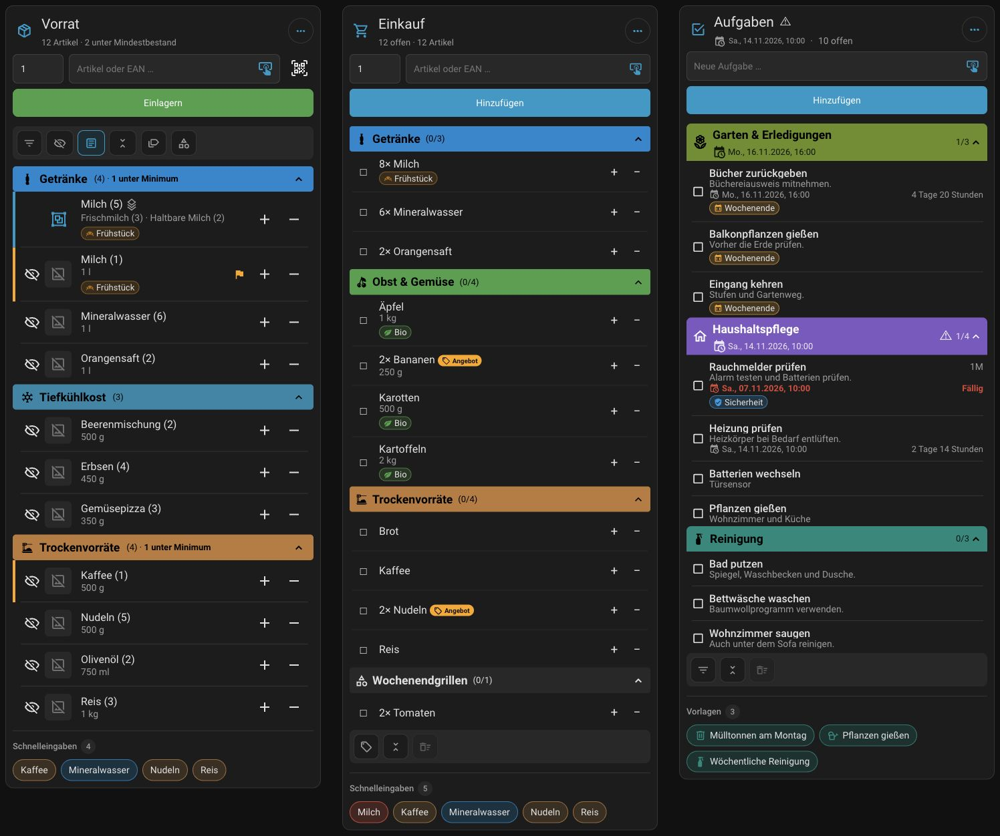

## Drei Listenarten

### Einkaufslisten

- Freie Artikel hinzufügen oder gespeicherte Produkte mit Bildern und Packungsgrößen auswählen.
- Anzahl und Beschreibungen verwalten.
- Schnelleingaben wiederverwenden und Artikel mit **Nur kaufen, wenn im Angebot** markieren.
- Angebote filtern und Artikel suchen.
- Zutaten aus gespeicherten Gerichten oder Tandoor-Rezepten auf lokale Einkaufslisten setzen.
- Artikel an eine andere Einkaufsliste senden, PDFs exportieren oder Benachrichtigungen verschicken.
- Bring!-Listen über die offizielle Bring!-Integration von Home Assistant verbinden.

### Inventar

- Separate Bestandslisten für Küche, Gefrierschrank oder Vorratsraum führen.
- Produkte einlagern, entnehmen, Bestände korrigieren und die letzte manuelle Buchung 60 Sekunden rückgängig machen.
- Zum Einlagern und Entnehmen Barcodes scannen; Bestände auch mit den Plus-/Minus-Buttons ändern.
- Mindestbestände festlegen und fehlende Artikel manuell oder automatisch nachbestellen.
- Nachbestellregeln pro Liste, Produkt oder Gruppe austauschbarer Produkte festlegen.

### To-do-Listen

- Aufgaben mit Notizen, Fälligkeit, Uhrzeit und Wiederholungsintervallen organisieren.
- Wiederverwendbare Aufgabenvorlagen anlegen und Fälligkeitswarnungen einstellen.
- Aufgaben suchen, nach Fälligkeit sortieren und erledigte Aufgaben ausblenden.
- Aufgaben unabhängig von Produkten und Barcodes verwalten.

**Mobile Kartenansichten im Dashboard**

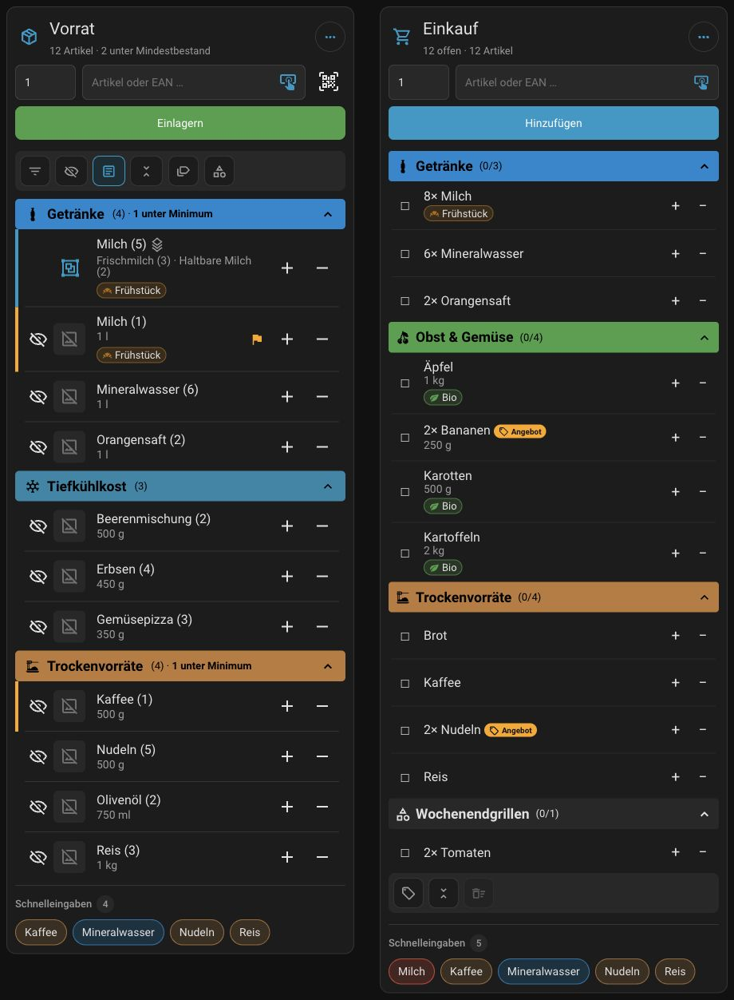

## Einkaufen mit Alexa

„Alexa, setze Gurken auf die Einkaufsliste“ — und der Eintrag landet in
HA List Manager. Dazu wird eine vorhandene Liste aus der HA-Integration
**Alexa Devices** einer lokalen Einkaufsliste zugeordnet.

- **Alexa als Eingang (empfohlen):** neue Einträge übernehmen und standardmäßig bei Alexa löschen.
- **Verknüpfte Artikel abgleichen:** zusätzlich Status, Löschungen und optional Mengen abgleichen.
- **Abgleich mit neuen lokalen Artikeln:** auch künftig neu angelegte lokale Artikel an Alexa senden.

Die optionale Mengen- und Einheitenerkennung verarbeitet gesprochene Angaben.
Aliasse ordnen mehrere Ausdrücke einem bestimmten Produkt oder einem anderen
Artikelnamen zu. Im Tab **Test** lässt sich das Ergebnis vorab ausprobieren.

## Gerichte und optionale Tandoor-Anbindung

- **Eigene Gerichte speichern:** Zutaten als freie Artikel oder verknüpfte
  Produkte zusammenstellen, etwa Tomaten, Zwiebeln und Knoblauch für eine
  Tomatensuppe. Beim Hinzufügen Zutaten auswählen, Anzahlen anpassen und
  Kategorien prüfen.
- **Tandoor Recipes verbinden (optional):** Eine vorhandene Tandoor-Instanz
  unter **HA List Manager → Einstellungen** mit Adresse und API-Token einrichten.
  In der Einkaufskarte Rezepte suchen oder ein Kochbuch auswählen, die
  Portionszahl anpassen und die gewünschten Zutaten auf die Einkaufsliste setzen.
  Die Portionsanpassung setzt entsprechende Angaben im Rezept voraus.

Gerichte und Tandoor lassen sich für jede lokale Einkaufsliste getrennt
aktivieren. Die Zutaten werden der Einkaufsliste hinzugefügt; es wird dabei
kein Inventarbestand gebucht.

[Anleitung zu Gerichten und Rezepten](https://github.com/Nisbo/ha-list-manager/wiki/Chips-Dishes-and-Recipes-DE)

## Kategorien und Labels in allen drei Listenarten

- **Kategorien** gliedern die Liste, etwa in Getränke, Backwaren oder Haushalt.
  Jeder Eintrag gehört zu einer Kategorie oder zu Allgemein.
- **Mehrere Labels pro Eintrag** ergänzen diese Ordnung. Milch kann zur Kategorie
  Getränke gehören und gleichzeitig die Labels Frühstück und Laktosefrei tragen.
  Bei Aufgaben könnten es Garten und Wochenende sein.
- **Nach Kategorien oder Labels gruppieren:** In der Labelansicht erscheint ein
  Eintrag unter jedem seiner Labels. Es bleibt derselbe Eintrag: Anzahl,
  Erledigt-Status und Änderungen werden in allen Ansichten übernommen.
- **Gemeinsam oder getrennt verwalten:** Kategorien und Labels können global,
  für einen Listentyp oder nur für eine Liste gelten, jeweils mit Symbol und Farbe.
  Bei gleichen Namen hat die einzelne Liste Vorrang vor dem Listentyp und Global.
- **Schnell auswählen und ändern:** über die Suche, die Ausklappliste,
  das Auswahlpopup oder die Schnellbuttons im Bearbeitungsdialog.

Automatische Kategoriezuordnungen sortieren neue Einträge anhand ihres Namens
ein. Schnelleingaben und Aufgabenvorlagen dienen dagegen zum schnellen Hinzufügen
wiederkehrender Artikel oder Aufgaben.

## Produktdatenbank

Die gemeinsame Produktdatenbank speichert optional EAN, Marke, Packungsmenge und
Bild. Unbekannte Barcodes lassen sich über Open Food Facts nachschlagen;
Produktdaten bleiben bearbeitbar. Das Löschen eines Einkaufsartikels löscht
weder sein Produkt noch verändert es den Inventarbestand.

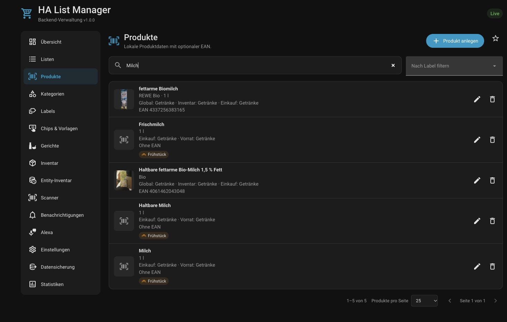

### Ein Blick in die Artikelbearbeitung

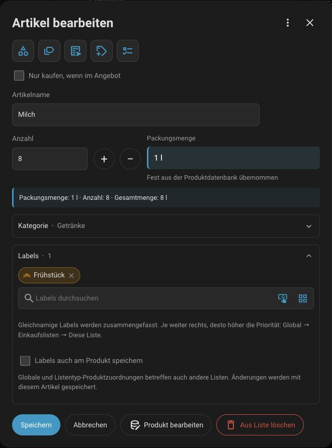

## Gemeinsam nutzen und Daten sichern

- Änderungen erscheinen auch auf anderen geöffneten Geräten. Scans werden zentral
  verarbeitet, selbst ohne offenes Dashboard; offene Scans haben eine gemeinsame Warteschlange.
- Normale angemeldete Benutzer bedienen die Listenkarten. Die Verwaltung bleibt Admins vorbehalten.
- Pro Liste ein HA-Skript und auslösende Ereignisse für Benachrichtigungen oder Sprachausgaben auswählen.
- Sicherungen erstellen, herunterladen und wiederherstellen oder Listen aus der ursprünglichen Improved Shopping List Card übernehmen.

## Entity-Verlauf

Ausgewählte HA-Entitäten langfristig archivieren, alte Historien importieren und
Messwerte korrigieren oder ausblenden. Die separate **Entity-Verlaufskarte** zeigt
bis zu fünf Entitäten als Diagramm oder chronologische Liste — inklusive
Referenzlinien und einstellbarer Anzeigepräzision.

**Diagramm**

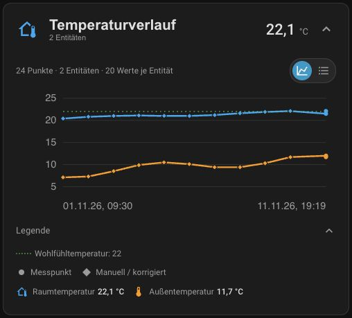

**Chronologische Liste**

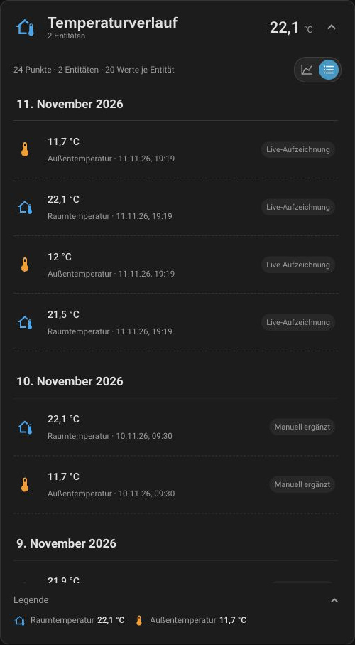

## Große Panelansichten

Im großen Panel bekommt der Listeninhalt mehr Platz. Dieselben Listen bleiben
auch in den kompakten Dashboard-Karten verfügbar.

### Einkaufsliste

**PC**

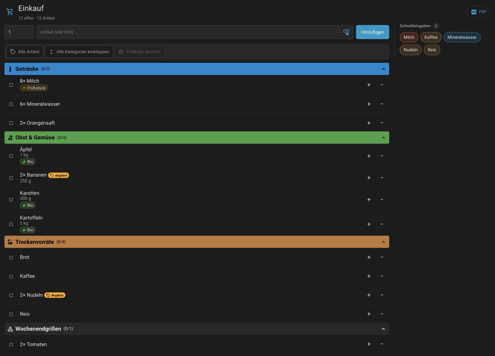

**Tablet**

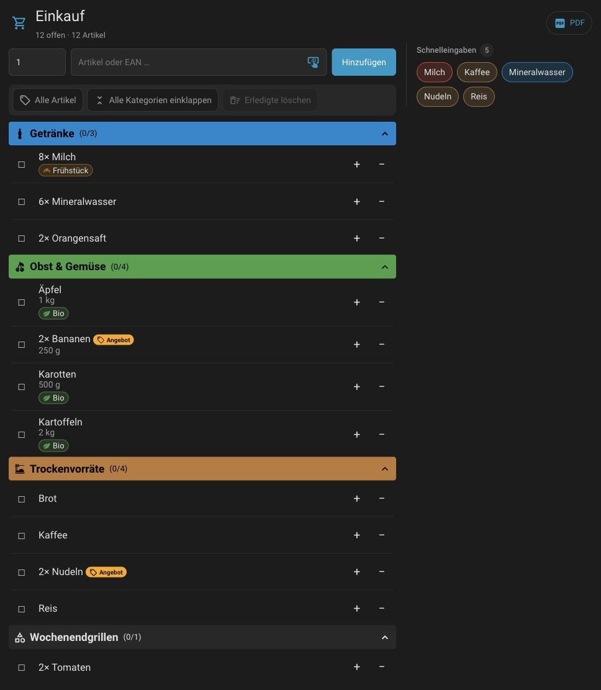

### Inventar

**PC**

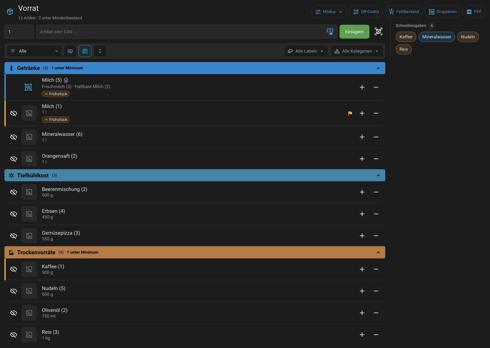

**Tablet**

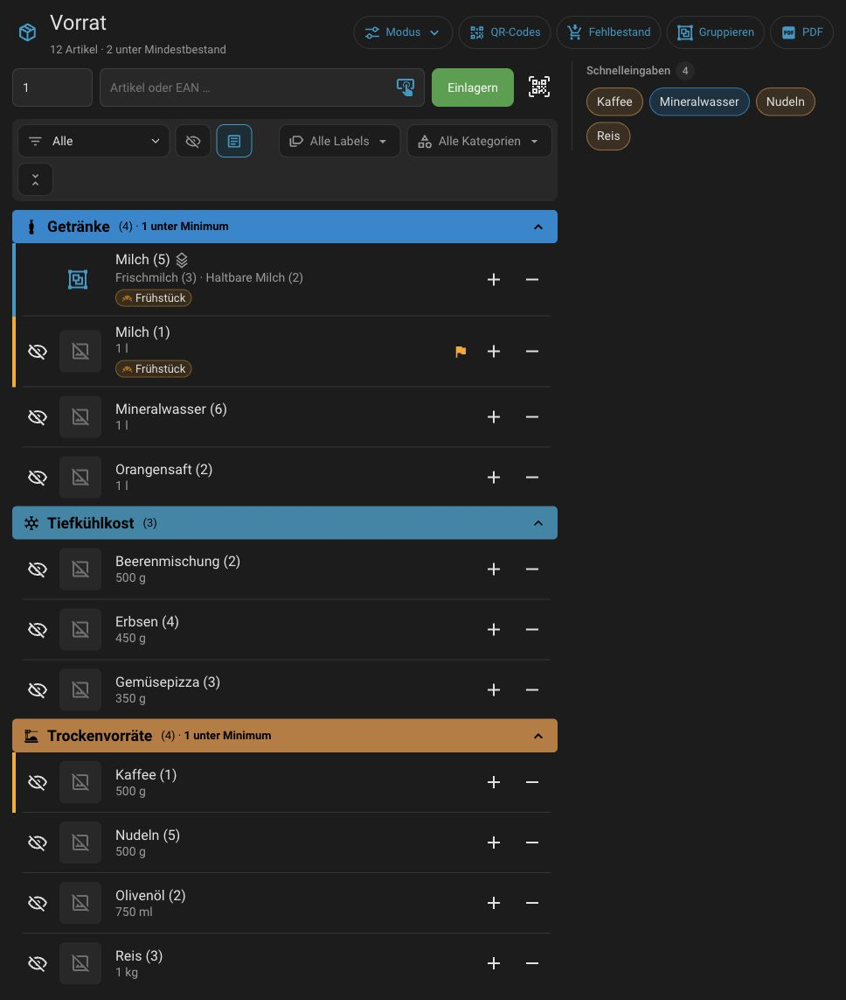

### To-do-Liste

**PC**

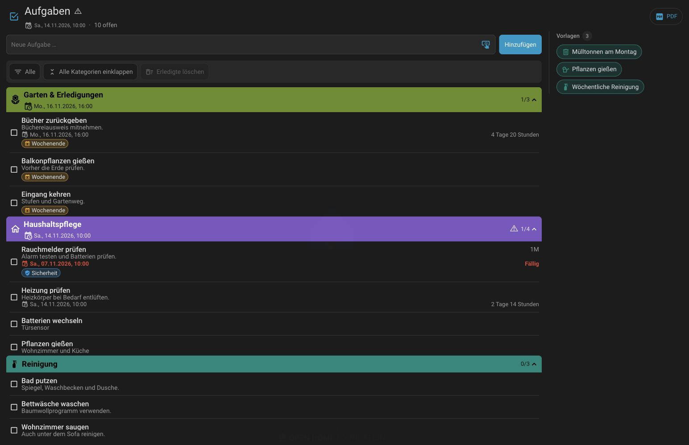

**Tablet**

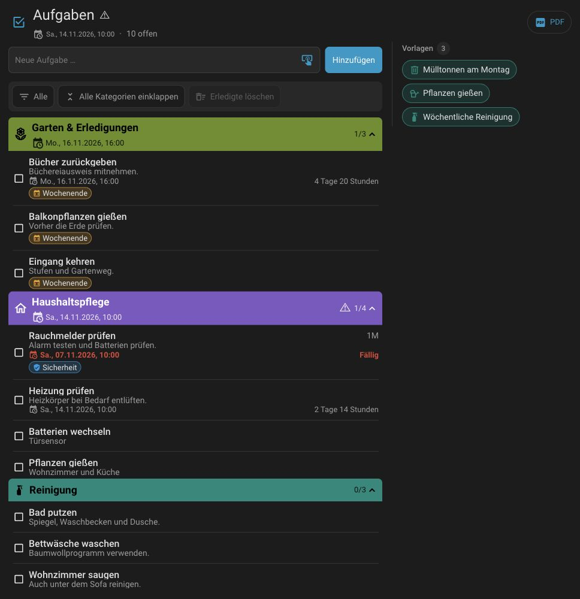

<!-- ha-marketplace:exclude-start -->
## Installation

Über **Marketplace** ab Home Assistant **2026.11**. Installation und Einrichtung
erfordern ein Administratorkonto.

1. Den blauen Button anklicken oder unter **Einstellungen → Marketplace → Über Link hinzufügen**
   `https://github.com/Nisbo/ha-list-manager` eintragen.
2. Falls erforderlich GitHub verbinden, **Integration** wählen und HA List Manager installieren.
   Anschließend Home Assistant neu starten.
3. Unter **Einstellungen → Geräte & Dienste → Integration hinzufügen** nach **HA List Manager** suchen.
4. In der HA-Seitenleiste **HA List Manager → Listen → Liste anlegen** öffnen
   und den gewünschten Listentyp auswählen.
5. Das Dashboard bearbeiten, **Karte hinzufügen** wählen und nach **HA List Manager** suchen.
   **HA List Manager – Einkaufsliste**, **HA List Manager – Inventar** oder
   **HA List Manager – To-do-Liste** auswählen und in der Karte die angelegte Liste wählen.
   Für aufgezeichnete Entitätsverläufe gibt es zusätzlich **HA List Manager – Entity-Inventar**.

**Manuelle Installation (HA 2026.10+):** Installationsarchiv unter
[Releases](https://github.com/Nisbo/ha-list-manager/releases) herunterladen und
so entpacken, dass `custom_components/ha_list_manager/manifest.json` im
HA-Konfigurationsverzeichnis liegt. HA neu starten und mit Schritt 3 fortfahren.
<!-- ha-marketplace:exclude-end -->

## Anleitungen und Hilfe

[Schnellstart](https://github.com/Nisbo/ha-list-manager/wiki/Quick-Start-DE) ·
[Einkaufslisten](https://github.com/Nisbo/ha-list-manager/wiki/Shopping-Lists-DE) ·
[Inventar](https://github.com/Nisbo/ha-list-manager/wiki/Inventory-DE) ·
[To-do](https://github.com/Nisbo/ha-list-manager/wiki/To-do-Lists-DE) ·
[Alexa](https://github.com/Nisbo/ha-list-manager/wiki/Alexa-DE) ·
[Gerichte und Rezepte](https://github.com/Nisbo/ha-list-manager/wiki/Chips-Dishes-and-Recipes-DE) ·
[Scanner](https://github.com/Nisbo/ha-list-manager/wiki/Scanners-DE) ·
[Datensicherung](https://github.com/Nisbo/ha-list-manager/wiki/Backup-and-Restore-DE)

Fehler und Verbesserungsvorschläge bitte unter [GitHub Issues](https://github.com/Nisbo/ha-list-manager/issues) melden.

[MIT-Lizenz](LICENSE) · [Lizenz der mitgelieferten PDF-Bibliothek](custom_components/ha_list_manager/frontend/PDF-LIB-LICENSE.md)
